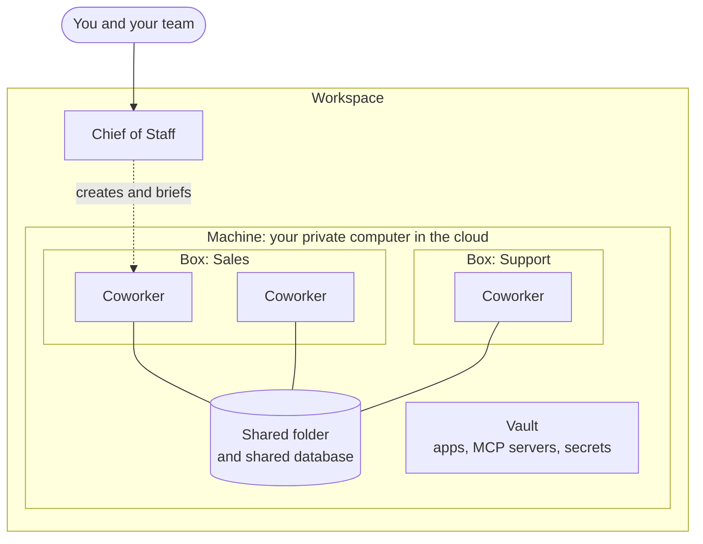

## Workspace

Your account. It holds your plan, your members, your Boxes and your coworkers, and it runs on one machine: a private computer in the cloud, isolated from every other account, that hosts every coworker of the workspace and holds the files, the databases and the credentials they share. You can belong to several workspaces and switch between them from the pill in the top left corner of the app.

An [API key](/api/authentication) is scoped to exactly one workspace.

Boxes arrange coworkers, the machine runs them all: the shared folder and the shared database are common to every coworker, whichever Box it sits in, and each app of the Vault reaches the coworkers you switch it on for.

## Backups

Rerun backs up the machine of every paid workspace each night: the coworkers, their memories, skills and sessions, the files, the shared database and the Vault. A backup is encrypted and stored away from the machine.

- It is taken during the night of your time zone, at 02:00 UTC until Rerun knows it. The coworkers pause while it is taken, usually less than a minute, and a coworker in the middle of a run is never cut off: the backup waits for the run to end.
- Each backup is kept for 7 days, and the one of the night from Saturday to Sunday for 4 weeks.
- A workspace in its trial or paused is not backed up. A paused workspace is saved once, for 90 days: see [Cancelling](/billing#cancelling).
- The backups are not in the app. If something went wrong on your machine, write to [help@rerun.build](mailto:help@rerun.build) and we restore it.

A self-hosted Rerun backs up nothing on its own: see [Backups](/self-host/servers#backups).

## Chief of Staff

The assistant every workspace comes with. It works like a coworker, with skills, knowledge, routines and apps of its own, and it reaches further than one: it works on the whole workspace. It builds your first team with you, creates and briefs coworkers, follows their runs, keeps the Brain with you and answers your questions about Rerun. It also checks in on its own, and writes to you when something is worth your time. You can give it a name. See [Chief of Staff](/chief-of-staff).

<Note>
  The code and the API call the Chief of Staff the `foreman`. Same thing.
</Note>

## Box

A room of your workspace: on the board it is the rectangle your coworkers sit on. It groups them by team, by client or by project.

A Box is instant and free, and you make as many as the work needs. It arranges coworkers, it does not separate them: every coworker of the workspace runs on the same machine, and the **shared folder** and the **shared database** are common to all of them, whichever Box they sit in. What a Box does decide is who reaches its coworkers: see [Access by Box](/teams#access-by-box).

Because a Box holds nothing of its own, moving a coworker from one to another costs nothing: right-click it on the board and pick **Move to Box**, or ask the Chief of Staff to do it. It keeps its files, its handle, its skills and its whole history.

To create a coworker right in a Box, right-click the Box on the board and pick **New coworker**: the window opens on the suggestions of that Box, and the coworker lands in it. Only an admin or a manager of the Box can do it.

The [Brain](/brain) stays one for the whole workspace, but it files each page and file under a Box: what a coworker adds goes under its Box, and its coworkers read it first. See [Filed by Box](/brain#filed-by-box).

<Note>
  The Rerun API calls a Box a `space`, in tool names like `list_spaces` and `space_db_query`. Same thing.
</Note>

## Coworker

<Note>
  The Rerun API calls a coworker an `agent`, in tool names like `create_agent` and `list_agents`, and in the `/agents` paths of these docs. Same thing.
</Note>

An AI worker inside a Box. It has:

| | |
| --- | --- |
| **A name** | Free text, what you see. Rename it whenever you want |
| **A handle** | The `@mention` key other coworkers call it by. Renaming the coworker re-derives it and rewrites every `@oldhandle` |
| **A soul** | Its system prompt: who it is, what it owns, how it works |
| **A model** | The provider and model it thinks with, changeable per conversation |
| **Capabilities** | Which families of tools it may use, from files to shell to browser |
| **Memory, skills, files, a database** | All private to it |

## Coworker panel

Click a coworker to open its chat. Its card opens the screens below, each with the tabs that answer the same question:

| Screen | Tabs |
| --- | --- |
| **Apps** | **Apps**, **MCP** |
| **Skills** | **Skills** |
| **Knowledge** | **Knowledge**, the coworker's memory |
| **Files** | **Files**, **Published** |
| **Database** | **Database** |
| **Routines** | **Scheduled**, **Triggers** |
| **Activity** | **Monitoring**, **Logs** |
| **Settings** | **General**, **Capabilities**, **Install** |

## Soul

The coworker system prompt, written in markdown. It is the single most important thing about a coworker. Edit it in the **General** tab of the coworker's **Settings**, or let the coworker rewrite it as it learns, which its **Edit own soul** capability allows.

## Skill

A written procedure the coworker loads on demand, when the task matches its description. It is a folder: a markdown body plus optional reference files.

Skills keep a coworker sharp without bloating its prompt: only a one-line index of every skill is always in context, and the full text loads when it is needed. See [Skills](/agents/skills).

## Memory

Durable facts the coworker writes down and recalls later, listed in its **Knowledge** screen. Memories fade if nothing uses them, and each recall extends their life, so what matters stays and what does not quietly retires.

Correct a coworker once and it remembers the correction.

## Brain

The pages about your company that every coworker reads before it works: what you sell, to whom, your team, your voice, your tools. Rerun fills it from your website, you edit it like a document, and coworkers propose changes that land in **Proposals** until you accept them. Open it from the workspace pill, then **Brain**. See [Brain](/brain).

## App

A ready-made integration with an external service: Stripe, Gmail, Notion, Slack and hundreds more. It gives a coworker that service's tools plus a skill explaining how to use them.

## Vault

Where the apps of the workspace live. You sign in to an app once, in the Vault, then pick the coworkers that use it, or **Every coworker**. It also holds MCP servers and secrets the coworkers read. Open it from the workspace pill, then **Vault**. See [Vault](/vault) and [Apps](/agents/apps).

LinkedIn Pro and WhatsApp Pro are [paid apps](/billing#paid-apps), attached coworker by coworker.

## MCP server

The open standard Rerun apps are built on. When the library does not have what you need, you can register any MCP server yourself, with its own URL, headers or command.

## Run

One execution of a coworker. It starts when you send a message, when a routine fires, when a webhook is called, or when another coworker calls it. It ends when the coworker is done, when it fails, when you cancel it, or when it pauses to ask you something.

Every run records its steps, its tool calls, its tokens and its cost. Read them in the **Monitoring** and **Logs** tabs of the coworker's **Activity** screen, or with [`get_run`](/api/tools/runs#get_run).

## Session

A conversation with a coworker. A run belongs to a session.

Every coworker has one **General** conversation. Every other one is a thread: open one with **New thread**, and find them in the coworker's **Threads**: **All**, **Chats** and **Automations** each list their 200 most recent threads, **Needs you** the ones waiting on you. A thread another coworker opened with yours shows only in **All**. Scheduled and triggered runs each open their own thread, so an automated run never pollutes your chat.

## Routine

A recurring instruction, on a schedule and in a timezone, or a one-off at a given date. When it fires, the coworker runs with no user message and follows the instruction. Routines live in the coworker's **Routines** screen. See [Automations](/agents/automations).

## Trigger

A public webhook URL that starts a run when it is called. The caller payload is handed to the coworker alongside your instruction. The URL is the credential. See [Webhook triggers](/api/webhooks).

## Template

A packaged coworker setup, published in the marketplace, that anyone can install into their own workspace in one click. It carries prompts, skills, scheduled tasks, app declarations and files, but never memories or credentials.

Templates can be free or paid. See [Templates](/templates/install).

## Board

The isometric view of your workspace. Boxes are drawn as rectangles, coworkers sit on them, and clicking a coworker opens its panel.

## Classic view

The other way to see the workspace: the Chief of Staff and your coworkers on the left, the chat in the middle, and the coworker's card on the right, which opens when you click the coworker at the top left of the chat. The speech bubble button at the top right lists all its conversations. You pick one of the two at the end of the onboarding questions, and switch anytime from the workspace pill, on the **View** row: **Board** or **Classic**. The choice is kept on each device. The board is the only view while your onboarding runs.

The list on the left reads your coworkers by Box, the Chief of Staff above them all. Create a Box from the button beside **Coworkers**, fold one away by clicking its name, and rename it, choose who can access it or delete it from its **…** menu or a right click. Drag a Box by its name to reorder the list, which takes managing every Box of the workspace, as an admin does, and drag a coworker to rank it in its Box or to move it into another one you manage: the order is the same for everyone in the workspace. A coworker's own **…** menu, or a right click on it, opens its conversations or its card, duplicates it, moves it to another Box or deletes it; deleting asks you to type its name first. A dot beside a coworker tells where it stands: green while it works, orange when it waits for you, red when something went wrong, grey when it is asleep or paused. A result nobody has opened yet shows as its own dot while the coworker is at rest, asleep or paused.

Drag the list's right edge to make it wider or narrower, between 240 and 420 pixels (and never more than 35% of the window). The browser keeps the width you chose; double-click the edge to bring it back to 288 pixels.
